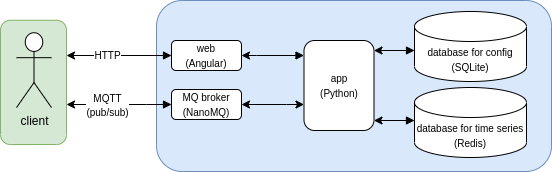
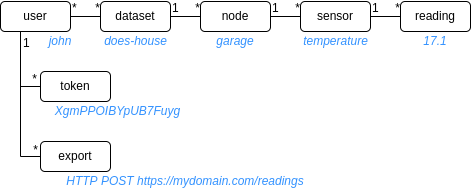

# datahub (Redis version)

## About
A very fast database with to hold your IoT data and a Web UI
to view it, both in table form and graphs.
Use the REST API to store and retrieve time series
of numbers or use the built-in MQ broker to publish
or subscribe to your data over MQTT.

### Background
I have many IoT devices generating data and need to store that
data somewhere. After searching I did not find any existing
projects or free/cheap services the offered the simplicity I
was looking for so I decided to write my own IoT database.

### History
This is a re-design of my previous project [datahub](https://github.com/fjaderboll/datahub), which is based on SQLite and PHP.
Check that out if you want something that can be deployed simply on a web server.

## Quick start
Everything runs in a single Docker container:
```shell
docker run \
	-d \
	--name datahub \
	--restart unless-stopped \
	-p 8080:8080 \
	-p 1883:1883 \
	-v datahub-data:/data \
	ghcr.io/fjaderboll/datahub-redis:latest
```

* Navigate to [http://localhost:8080/](http://localhost:8080/) and create the first user, which becomes administrator.
* REST API documentation (Swagger) is at [http://localhost:8080/api/](http://localhost:8080/api/).
* The MQTT broker is at `localhost:1883`, log in with your datahub username and password.
	- Publish readings to a dataset you have created, for example
  `in/datasets/home/nodes/kitchen/sensors/temperature/readings` with `{"value": 21.5}`,
	- Subscribe to `out/datasets/home/#` to get them pushed to you.

## Overview


### Storage
Readings are stored in [Redis](https://redis.io/) time series, which keeps them in memory
for fast access and avoids unnecessary disk writes.
Users, datasets, nodes and sensors are stored in [SQLite](https://www.sqlite.org/).

### Entities
Structure of entities with examples:



## File structure

* [app](app/README.md) - Application backend (where it all happens)
* [web](web/README.md) - Web frontend (administration and viewing data)
* [docker](docker/README.md) - Building the Docker image

## Testing
See [test](test/README.md) for a simple test script.
This is also one way to create an user and some example
data if you just want to have a look around.

### Performance
Inserting 1000 readings takes:
* 2.4 seconds over HTTP, one reading per request
* 0.4 seconds over HTTP, all readings in one request
* 1.1 seconds over MQTT, one reading per message (until all are published back out)
This scales quite linearly with the number of readings.

Loading those 1000 readings takes 0.01 seconds, in a single request.

Measured with [performance.py](test/performance.py) and the Docker image on an AMD Ryzen 7 5800X,
with one client on the same machine sending one request at a time.

### Memory footprint
Storing 100 million readings takes about 600 MB of RAM (measured on an instance with
170 sensors and a few years of real data). The exact figure depends slightly on the data;
values that change little and arrive at regular intervals compress better.

The snapshot on disk (`/data/redis/dump.rdb`) is about 90% of the RAM usage.
